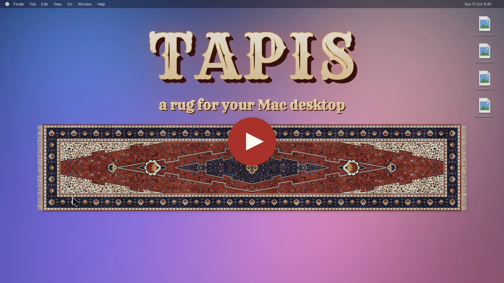
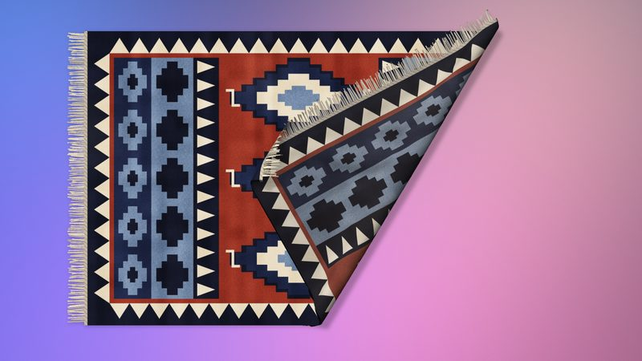
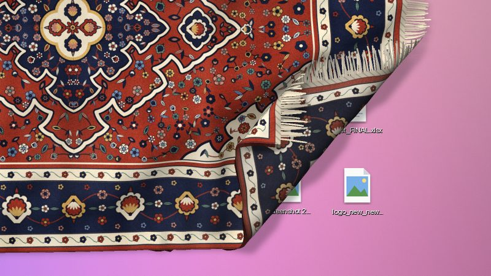
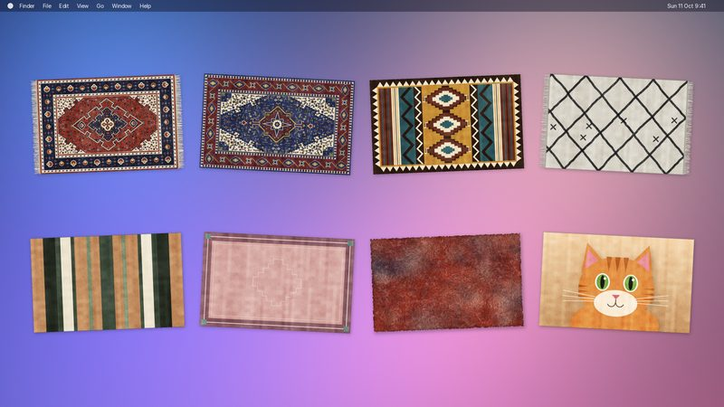
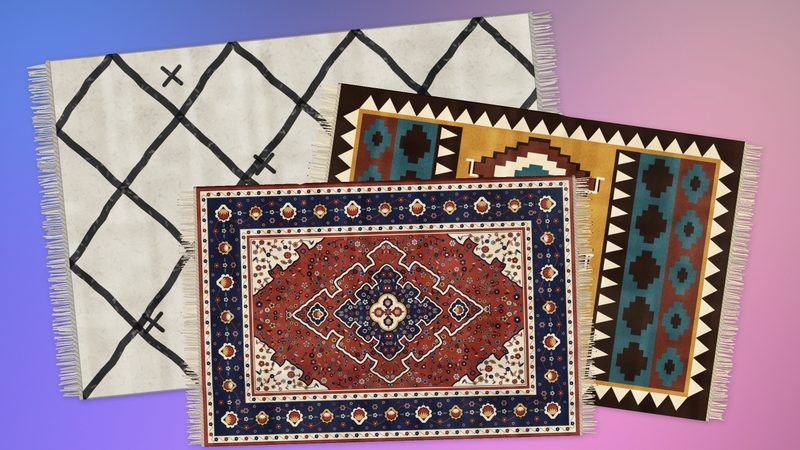
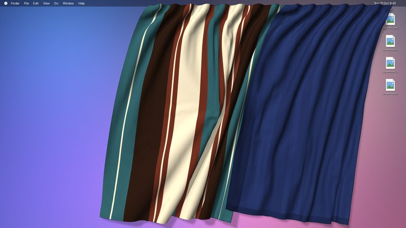

# Tapis, virtual Desktop Rugs and Curtains for macOS

*Tapis is a physically simulated rug that sits above or below your desktop icons and apps: sweep the clutter under it, fold it, roll it up, move it around, or weave it a pattern of your own. Or hang curtains from the menu bar, and draw them open or closed over your desktop.*

Downloads and the update feed for **Tapis**: cloth rugs that lie on your Mac desktop, and curtains that hang from its menu bar.

**Website:** [rlods.github.io/tapis](https://rlods.github.io/tapis/)

The source code is not in this repository yet.

## Features

<table>
  <tr>
    <td width="33%"> <b>Fold and curl</b> Grab any part to lift, fold or curl it. Double-click to smooth it out.</td>
    <td width="33%"> <b>Drapes over your icons</b> Each desktop icon makes a bump under the rug. Sweep the clutter under it.</td>
    <td width="33%"> <b>Design your own</b> Persian, Heriz, Kilim, Berber, Stripes, Bordered, Shag, or your own picture.</td>
  </tr>
  <tr>
    <td> <b>Stack several rugs</b> Rugs rest on one another. Save sets of them as arrangements.</td>
    <td> <b>Curtains too</b> Hang curtains from the menu bar. Slide them, draw them, swish them.</td>
    <td></td>
  </tr>
</table>

## Install

Requires macOS 14 or later on Apple silicon.

1. Download the latest DMG from the [Releases](https://github.com/rlods/tapis/releases/latest) page.
2. Open it and drag **Tapis** to your **Applications** folder.
3. Launch Tapis. Its icon appears in the menu bar.

Tapis checks `https://rlods.github.io/tapis/appcast.xml` to detect and suggest updates.

## Support

Tapis is free. If it made your desktop a little cozier, you can [buy me a coffee on Ko-fi](https://ko-fi.com/rlods) or [sponsor it on GitHub](https://github.com/sponsors/rlods).

## Privacy by design

No account. No analytics. The only network call is the update check, and it sends nothing about you. Updating is always your choice. Tapis runs entirely on your Mac, and your rugs and curtains never leave it.

## Inspiration

The idea comes from [a tweet by Terkel](https://x.com/terkelg/status/2107541877176094880): a fun idea, and just as much fun to build.

## License

[MIT](LICENSE) © 2026 Romain Lods
