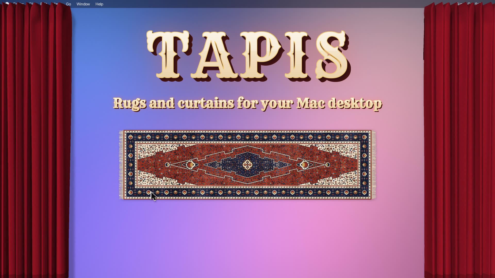

# Tapis, virtual Desktop Rugs for macOS

Downloads and the update feed for **Tapis**, a cloth rug that lies on your Mac desktop.

*Tapis are physically simulated rugs that sits above or below your desktop icons and apps: sweep the clutter under it, fold it, roll it up, move it around, or weave it a pattern of your own.*

- **Download:** the latest DMG is on the [Releases](https://github.com/rlods/tapis/releases/latest) page.
- **Updates:** Tapis checks `https://rlods.github.io/tapis/appcast.xml` to detect and suggest updates.

The source code is not in this repository.

## Inspiration

The idea comes from [a tweet by Terkel](https://x.com/terkelg/status/2107541877176094880): a fun idea, and just as much fun to build. Thank you!
